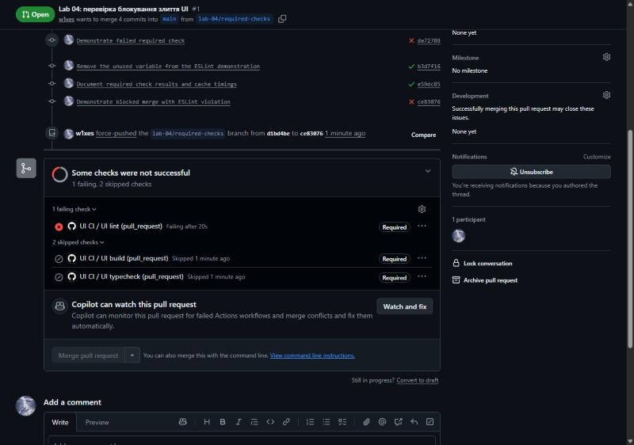
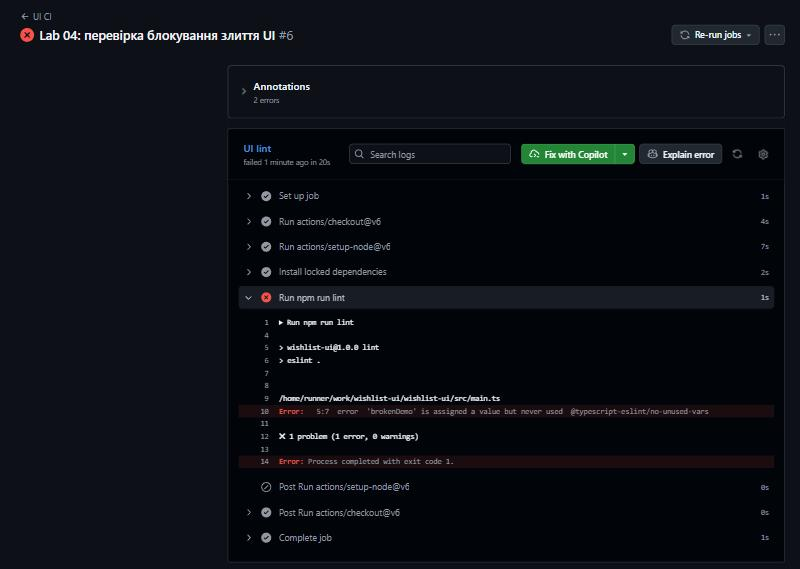
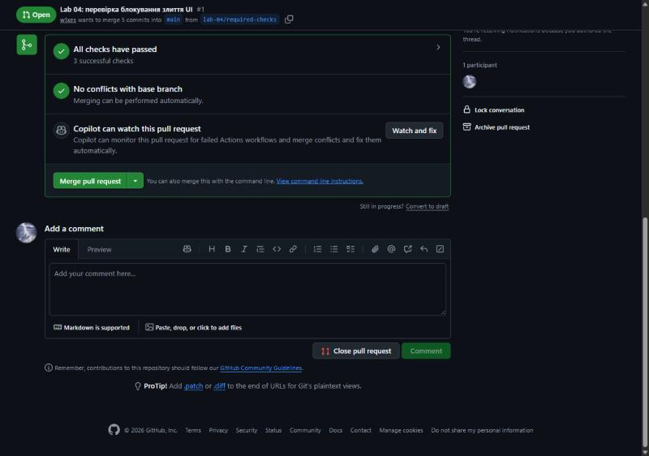

# Перевірки Wishlist UI

## Обов’язкові перевірки

Для `main` діє ruleset із обов’язковим pull request, актуальністю щодо `main`, скиданням застарілих схвалень і забороною видалення та force-push. Список обходу порожній. В індивідуальній роботі кількість обов’язкових схвалень дорівнює нулю. Для злиття мають пройти `UI lint`, `UI typecheck` і `UI build`. [Налаштування ruleset](https://github.com/w1xes/wishlist-ui/rules/27492372)

Доказ блокування — [PR №1](https://github.com/w1xes/wishlist-ui/pull/1). У ньому коміт `ce83076` навмисно додав невикористану змінну `brokenDemo` у `src/main.ts`, а коміт `dd06a0a` її прибрав.

**1. Червона перевірка й заблокована кнопка злиття.** На коміті `ce83076` впав `UI lint`, а `UI typecheck` і `UI build` пропущено. Кнопка **Merge pull request** неактивна. [Прогін](https://github.com/w1xes/wishlist-ui/actions/runs/45461054407)

**2. Рядок помилки в журналі.** Крок `Run npm run lint` повідомив `5:7 error 'brokenDemo' is assigned a value but never used @typescript-eslint/no-unused-vars` у `src/main.ts`. [Журнал ESLint](https://github.com/w1xes/wishlist-ui/actions/runs/45461054407/job/138683402689)

**3. Той самий pull request після виправлення.** Коміт `dd06a0a` прибрав зайву змінну. `UI lint`, `UI typecheck` і `UI build` зелені, кнопка **Merge pull request** активна. [Успішний прогін](https://github.com/w1xes/wishlist-ui/actions/runs/45461435191)

## Вимірювання кешу

Дві спроби того самого прогону на `main`, коміт `e1097ff`. Час узято з міток початку й завершення спроб у GitHub Actions.

| Прогін | Час |
|---|---:|
| [Без кешу](https://github.com/w1xes/wishlist-ui/actions/runs/44166606744/attempts/1) | 87 с |
| [З кешем](https://github.com/w1xes/wishlist-ui/actions/runs/44166606744/attempts/2) | 73 с |

Найдовший крок — `Run actions/setup-node@v6` у `UI typecheck`, 10 с у другій спробі.

У першій спробі `UI lint` заповнив кеш npm. Наступні завдання першої спроби та всі завдання другої відновили його. Повний прогін скоротився на 14 с.

## Нічний аудит

Окремий workflow `UI dependency audit` запускає `npm audit`. Ручний контрольний запуск 17 листопада завершився з помилкою через транзитивну залежність `picomatch` ([GHSA-fc5q-39xc-vjpf](https://github.com/advisories/GHSA-fc5q-39xc-vjpf)), а обов’язкові перевірки PR пройшли. 18 листопада GitHub відкликав цей advisory, після чого нічні запуски стали зеленими. Залежності в репозиторії не змінювалися. [Результат аудиту](https://github.com/w1xes/wishlist-ui/actions/runs/44167184838)
