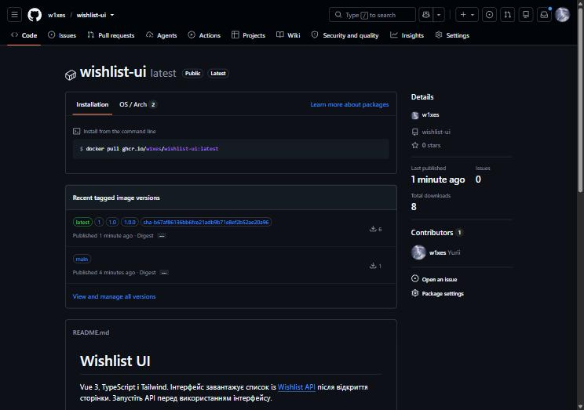

# Образ UI (лабораторна 5)

Інтерфейс збирається в образ у два етапи: Node збирає `dist/`, nginx віддає його. У фінальному образі лише nginx і зібрані файли. Стек із Postgres, Redis, API та UI, CI, діагностика збоїв і пояснення для захисту описані в [docs/containers.md репозиторію wishlist-api](https://github.com/w1xes/wishlist-api/blob/main/docs/containers.md). Сам `compose.yaml` лежить там, у цьому репозиторії `compose.yaml` лише для dev-режиму з Vite (порт 5174).

Виміри зроблено на Windows 11 з Docker Desktop. Для експериментів використано тимчасові теги `lab5-ui:*`, після вимірів їх видалено.

## Файли

| Файл | Що робить |
|---|---|
| `Dockerfile` | етап `build` (Node) і фінальний етап (nginx) |
| `.dockerignore` | не пускає в контекст `.env*`, `node_modules`, `dist`, `.git`, документацію |
| `nginx/default.conf` | перехід на `index.html`, кеш хешованих файлів, gzip, заголовки |
| `src/App.vue` | читає адресу API з `import.meta.env.VITE_API_BASE`, запасне значення `http://localhost:8000` |
| `.env.example` | `VITE_API_BASE` і `UI_PORT` для dev-режиму |
| `compose.yaml` | лише dev-режим (Vite, порт 5174); змінну перейменовано з `VITE_API_URL` на `VITE_API_BASE` |
| `.github/workflows/ci.yml` | завдання `UI image` збирає й публікує образ, `UI image scan` сканує |

## Dockerfile

```dockerfile
FROM node:24-alpine AS build
WORKDIR /app

COPY package.json package-lock.json ./
RUN npm ci --no-audit --no-fund

COPY . .

ARG VITE_API_BASE=http://localhost:8000
ENV VITE_API_BASE=$VITE_API_BASE
RUN npm run build


FROM nginx:1.30-alpine
COPY nginx/default.conf /etc/nginx/conf.d/default.conf
COPY --from=build /app/dist /usr/share/nginx/html
EXPOSE 80
```

| Рядок | Навіщо |
|---|---|
| `FROM node:24-alpine AS build` | етап названо `build`. Node 24 збігається з `engines` у `package.json`. Тег веде на актуальний патч гілки 24 (під час вимірів Node 24.22.1), це не digest |
| `COPY package.json package-lock.json` і `RUN npm ci` | залежності встановлюються до копіювання коду. `npm ci` ставить точно те, що записано в `package-lock.json`, і падає, якщо lock-файл не збігається з `package.json`. `npm install` цього не гарантує |
| `COPY . .` | код копіюється після залежностей. Правка в `src/` не скидає шар `npm ci` |
| `ARG VITE_API_BASE=http://localhost:8000`, `ENV VITE_API_BASE=$VITE_API_BASE` | адреса API, яку Vite вшиває в бандл під час `npm run build`. `ARG` оголошено після `npm ci`, тому зміна адреси перебудовує лише останній шар. Значення не секретне (публічна адреса, яку й так видно в бандлі). `ENV` існує лише на етапі `build` |
| `RUN npm run build` | створює `dist/` |
| `FROM nginx:1.30-alpine` | фінальний етап. Конкретна гілка nginx (під час вимірів 1.30.8), без `latest` |
| `COPY nginx/default.conf` | наша конфігурація замість стандартної |
| `COPY --from=build /app/dist` | з етапу `build` переноситься лише зібраний `dist/`. Node, `node_modules` і вихідний код у фінальний образ не потрапляють |
| `EXPOSE 80` | документація порту |

`CMD` у фінальному етапі не перевизначено, діє команда образу nginx у exec-формі: `["nginx", "-g", "daemon off;"]`. PID 1 це `nginx: master process nginx -g daemon off;`, без оболонки:

Вивід `ps` усередині контейнера і час зупинки:

```
PID   USER     COMMAND
    1 root     nginx: master process nginx -g daemon off;
   29 nginx    nginx: worker process
   30 nginx    nginx: worker process
   31 nginx    nginx: worker process
   32 nginx    nginx: worker process
docker stop took 0.613612 s
```

Головний процес nginx працює від root (потрібно для порту 80), робочі процеси від користувача `nginx`. Вимога «не root» стосувалась лише образу API.

### .dockerignore

```
.env
.env.*
node_modules
dist
.git
.github
docs
*.md
Dockerfile
.dockerignore
compose*.yaml
```

`.env*` виключено, бо Vite читає файли `.env*` під час збирання й вшив би з них значення `VITE_*` у бандл. `node_modules` і `dist` з хоста не потрібні, бо вони перебудовуються всередині образу.

## nginx

```nginx
server {
    listen 80;
    server_name _;

    root /usr/share/nginx/html;
    index index.html;

    server_tokens off;

    gzip on;
    gzip_vary on;
    gzip_min_length 256;
    gzip_types text/plain text/css application/javascript application/json image/svg+xml;

    location / {
        try_files $uri $uri/ /index.html;
        add_header Cache-Control "no-cache" always;
        add_header X-Content-Type-Options "nosniff" always;
        add_header Referrer-Policy "strict-origin-when-cross-origin" always;
    }

    location /assets/ {
        try_files $uri =404;
        add_header Cache-Control "public, max-age=31536000, immutable";
        add_header X-Content-Type-Options "nosniff" always;
        add_header Referrer-Policy "strict-origin-when-cross-origin" always;
    }
}
```

| Фрагмент | Навіщо |
|---|---|
| `try_files $uri $uri/ /index.html` у `location /` | UI односторінковий і без роутера, але будь-який шлях, якого немає на диску, має віддавати `index.html`, інакше перезавантаження сторінки на глибокому шляху дало б 404 |
| `Cache-Control: no-cache` для `/` | браузер щоразу перевіряє `index.html`: в ньому написані імена хешованих файлів, і застарілий `index.html` посилався б на неіснуючі |
| `location /assets/` з `immutable` на рік | Vite додає хеш вмісту до імені кожного файла в `assets/`, тож файл із таким іменем ніколи не змінюється |
| `try_files $uri =404` у `/assets/` | відсутній файл в `assets/` це справжній 404, а не `index.html` зі статусом 200 |
| `add_header Cache-Control` без `always` у `/assets/` | заголовок для кешу на рік не додається до відповідей 404. Спершу `always` був, і 404 теж ставав кешованим на рік. Виправлено після першого виміру |
| повтор `X-Content-Type-Options` і `Referrer-Policy` у кожному `location` | директиви `add_header` у `location` повністю замінюють ті, що задано на рівні `server`, тому їх повторено |
| `server_tokens off` | у заголовку `Server` лише `nginx`, без версії |
| `gzip ...` | стискання тексту й JS/CSS |

## Розмір образів

```
$ docker build --target build -t lab5-ui:build .
$ docker build -t lab5-ui:test .
$ docker image inspect --format '{{.Size}}' lab5-ui:build lab5-ui:test node:24-alpine nginx:1.30-alpine
```

| Образ | Розмір |
|---|---|
| етап `build` (`docker build --target build`) | 457 314 679 байт (≈ 457 МБ) |
| фінальний образ | 101 413 792 байт (≈ 101 МБ) |
| для порівняння, `node:24-alpine` | 243 589 249 байт (≈ 244 МБ) |
| для порівняння, `nginx:1.30-alpine` | 101 246 184 байт (≈ 101 МБ) |

Фінальний образ приблизно в 4,5 раза менший за етап `build`. Власні файли додають до `nginx:1.30-alpine` лише близько 115 кБ (`COPY /app/dist` у `docker history` дорівнює 115 кБ). Образ, зібраний у стеку `compose.yaml` (`wishlist-ui:local`), має 101 413 946 байт, тобто на 154 байти більше.

**Що займає найбільше місця в етапі `build`:** базовий образ `node:24-alpine` (244 МБ, із них 126 МБ це бінарник `node`), далі `node_modules` (116 МБ, найбільші `typescript` 22,9 МБ, `esbuild` 10,9 МБ, `tailwindcss` 9,8 МБ, `lightningcss` 9,6 МБ).

Розбір етапу `build`:

Вивід `du` в етапі `build`:

```
116.2M	/app
115.9M	/app/node_modules
96.0K	/app/dist
22.9M	/app/node_modules/typescript
10.9M	/app/node_modules/@esbuild
9.8M	/app/node_modules/@tailwindcss
9.6M	/app/node_modules/lightningcss-linux-x64-musl
126.4M	/usr/local/bin/node
29.2M	/root/.npm
```

Шари етапу (`docker history`): `npm ci` 155 МБ (це `node_modules` і кеш npm 29 МБ у `/root/.npm`), `npm run build` 2,9 МБ, `COPY . .` 57,3 кБ. Кеш npm лишається в етапі `build`, але до фінального образу не потрапляє.

Бандл: JS 70,8 кБ (28,3 кБ gzip), CSS 8,4 кБ (2,6 кБ gzip), `index.html` 0,41 кБ.

## У фінальному образі немає Node, node_modules і вихідного коду

Вивід перевірок у контейнері з фінального образу (`which node`, `which npm`, `ls -la` каталогу сайту, `ls /app /node_modules /usr/local/bin/node`):

```
which node: []
which npm: []
/usr/share/nginx/html:
-rw-r--r--    1 root     root           497 Nov 19 20:38 50x.html
drwxr-xr-x    2 root     root          4096 Nov 24 19:51 assets
-rw-r--r--    1 root     root           407 Nov 24 19:51 index.html

/usr/share/nginx/html/assets:
-rw-r--r--    1 root     root         70837 Nov 24 19:51 index-TKX6JdLV.js
-rw-r--r--    1 root     root          8357 Nov 24 19:51 index-d7-0t28e.css
ls: /app: No such file or directory
ls: /node_modules: No such file or directory
ls: /usr/local/bin/node: No such file or directory
```

`which node` і `which npm` нічого не знаходять. У каталозі сайту лише `index.html`, `assets/` і стандартна сторінка nginx `50x.html`. У стеку те саме перевірено через `docker compose exec -T ui sh -c 'which node npm; ...'`: код виходу `which` дорівнює 1, у `/usr/share/nginx/html` лежать `50x.html`, `assets`, `index.html`.

## Перезавантаження будь-якого маршруту не дає 404

```
--- GET /
HTTP/1.1 200 OK
Cache-Control: no-cache
--- GET /some/deep/route
HTTP/1.1 200 OK
Cache-Control: no-cache
--- GET /assets/index-TKX6JdLV.js
HTTP/1.1 200 OK
Cache-Control: public, max-age=31536000, immutable
--- GET /assets/missing-abc.js
HTTP/1.1 404 Not Found
--- GET /missing.png
HTTP/1.1 200 OK
Cache-Control: no-cache
```

Тіло відповіді на `/some/deep/route` порівняно з `index.html`: збігається (`identical`). У стеку `curl -s -o /dev/null -w 'GET /some/deep/route -> %{http_code}\n' http://localhost:8081/some/deep/route` повертає `GET /some/deep/route -> 200`. Відсутній файл у `/assets/` дає справжній 404 без заголовка `immutable`. Шлях `/missing.png` теж повертає `index.html` зі статусом 200: це наслідок загального переходу на `index.html` і для SPA без роутера допустимо. Справжній 404 є лише в `/assets/`.

Заголовки відповіді `/`: `Server: nginx` (без версії), `X-Content-Type-Options: nosniff`, `Referrer-Policy: strict-origin-when-cross-origin`, `Content-Encoding: gzip`.

## ARG і змінна середовища

Образ зібрано з нестандартною адресою, потім контейнер запущено з іншою адресою у змінній середовища:

```
in container A (build-arg example.test:9999):
http://example.test:9999
other.test count: 0
in container B (run -e VITE_API_BASE=http://other.test):
env VITE_API_BASE=http://other.test
http://example.test:9999
other.test count in bundle: 0
example.test count in bundle: 1
```

У контейнері B змінна `VITE_API_BASE=http://other.test` існує, але бандл не змінився: адреса `http://example.test:9999` вшита під час збирання, `other.test` у бандлі немає. Збирання за замовчуванням, без `--build-arg`, вшиває `http://localhost:8000`. У самому фінальному образі змінної `VITE_API_BASE` у `Env` теж немає, бо `ENV` існує лише на етапі `build`.

Отже адреса API задається лише `--build-arg` (у `compose.yaml` стеку це `build.args.VITE_API_BASE`), а змінити її можна лише перезбиранням образу. Причина: Vite підставляє `import.meta.env.VITE_*` у JavaScript під час `npm run build`, а nginx віддає готові статичні файли й жодних змінних не читає.

## Захист від потрапляння `.env` у бандл

Перевірка: у локальний `.env` тимчасово записано `VITE_API_BASE=http://leaked.invalid` і додаткову змінну `VITE_SECRET_PROBE` зі значенням, що містить `leaked-probe`. Образ зібрано, пошук у бандлі:

```
build rc=0
. .. .gitignore dist eslint.config.js index.html nginx node_modules package-lock.json package.json src tsconfig.json vite.config.ts
leaked.invalid in bundle: 0
leaked-probe in bundle: 0
http://localhost:8000
```

Вивід `ls -a /app` в етапі `build` показує, що файлу `.env` у контексті немає. У бандлі немає жодного з тестових значень, а адреса `http://localhost:8000`. Попередження: оскільки в Dockerfile `ENV VITE_API_BASE` задано явно, значення з `.env` для цієї змінної перекрилось би й без `.dockerignore`. Тому доказом слугують тестова змінна `VITE_SECRET_PROBE` і список файлів. Початковий `.env` після перевірки відновлено, його вміст не змінився.

## Кеш шарів

Змінено один рядок у `src/App.vue` і перезібрано. Залежності з кешу, перебудовано лише копіювання коду та `npm run build`:

```
#8 [build 2/6] WORKDIR /app
#8 CACHED
#9 [build 3/6] COPY package.json package-lock.json ./
#9 CACHED
#10 [build 4/6] RUN npm ci --no-audit --no-fund
#10 CACHED
#11 [build 5/6] COPY . .
#11 DONE 0.0s
#12 [build 6/6] RUN npm run build
#12 DONE 2.1s
```

Холодна збірка етапу `build` близько 17 с, збірка після правки коду близько 2 с. Правку відкочено, файл збігається з резервною копією.

## Перевірки коду після перейменування змінної

У копії репозиторію (Node v24.21.0) пройшли `npm ci`, `npm run lint`, `npm run typecheck`, `npm run build` (Vite 7, 11 модулів), без попереджень у lint і typecheck.

## Опубліковані образи в GHCR

Реліз `v1.0.0` створено на коміті `b67af86` (злиття PR №2). Прогін на push у `main` ([run 45480573093](https://github.com/w1xes/wishlist-ui/actions/runs/45480573093)) опублікував теги `sha-<коміт>` і `main`, прогін на теґ ([run 45481176412](https://github.com/w1xes/wishlist-ui/actions/runs/45481176412)) додав `1.0.0`, `1.0`, `1` і `latest`. Усі п'ять job'ів (`UI lint`, `UI typecheck`, `UI build`, `UI image`, `UI image scan`) пройшли.

Теги пакета `ghcr.io/w1xes/wishlist-ui`, отримані з реєстру:

```
main  sha-b67af86136bb6fce21adb9b71e8ef2b52ae20a96  1.0.0  1.0  1  latest
```

Пакет публічний, образ завантажується без входу в реєстр.



```
$ docker pull ghcr.io/w1xes/wishlist-ui:1.0.0
...
Digest: sha256:ce1c9657cd28f4494f4f9061b182b5d21f71f11fbf43422b4d605f34332c57f5
Status: Downloaded newer image for ghcr.io/w1xes/wishlist-ui:1.0.0
ghcr.io/w1xes/wishlist-ui:1.0.0
```

### Дві архітектури під одним тегом

```
$ docker buildx imagetools inspect ghcr.io/w1xes/wishlist-ui:1.0.0
Name:      ghcr.io/w1xes/wishlist-ui:1.0.0
MediaType: application/vnd.oci.image.index.v1+json
Digest:    sha256:ce1c9657cd28f4494f4f9061b182b5d21f71f11fbf43422b4d605f34332c57f5

Manifests:
  Name:      ghcr.io/w1xes/wishlist-ui:1.0.0@sha256:85b78bd8f6a2ac1c55dc849c5d92ab420b66e55ed76f9be3459ceef7cfa47e5c
  MediaType: application/vnd.oci.image.manifest.v1+json
  Platform:  linux/amd64

  Name:      ghcr.io/w1xes/wishlist-ui:1.0.0@sha256:c4b0f3354186d6567a9c3bd9165005514e7b46f1184af1f13aa63cf818eaef0c
  MediaType: application/vnd.oci.image.manifest.v1+json
  Platform:  linux/arm64
```

### Сканування Trivy

Звіт `wishlist-ui-trivy-report` (артефакт [run 45481176412](https://github.com/w1xes/wishlist-ui/actions/runs/45481176412)) містить одну знахідку: `zlib 1.3.2-r1` (CVE-2026-4738, MEDIUM, виправлено в `1.4-r0`) в Alpine 3.24.4. Вона з базового образу nginx. Залежностей застосунку у фінальному образі немає, бо там лише `dist/`.

### Адреса API у опублікованому образі

Образ зібрано з `VITE_API_BASE=http://localhost:8000`, бо змінної репозиторію `VITE_API_BASE` немає. Для локального стека це правильно. Для розгортання на PaaS потрібна змінна репозиторію з адресою розгорнутого API або перезбирання образу з іншим `--build-arg`.

### Ruleset

`main` вимагає `UI lint`, `UI typecheck`, `UI build` і `UI image`. [Налаштування ruleset](https://github.com/w1xes/wishlist-ui/rules/27492372). Job `UI image scan` у списку немає.

## Що далі

Стек із Postgres, Redis, API і UI однією командою, том із даними, секрети, діагностика поломок, публікація образів у GHCR, Trivy, multi-arch і режим розробки описані в [wishlist-api/docs/containers.md](https://github.com/w1xes/wishlist-api/blob/main/docs/containers.md).
